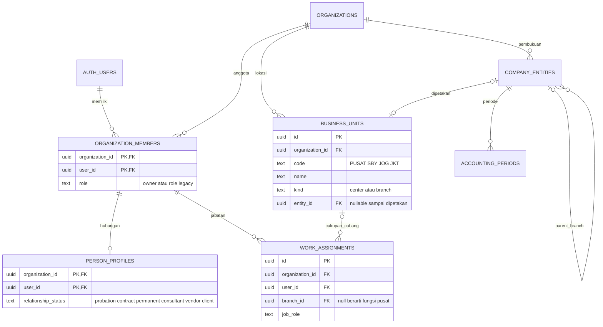
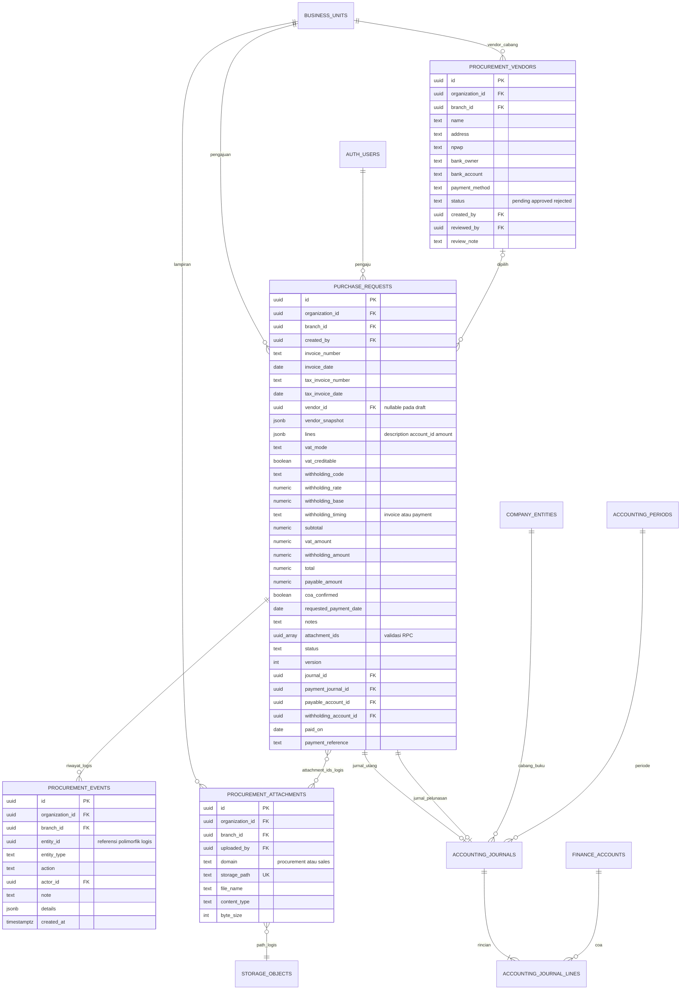
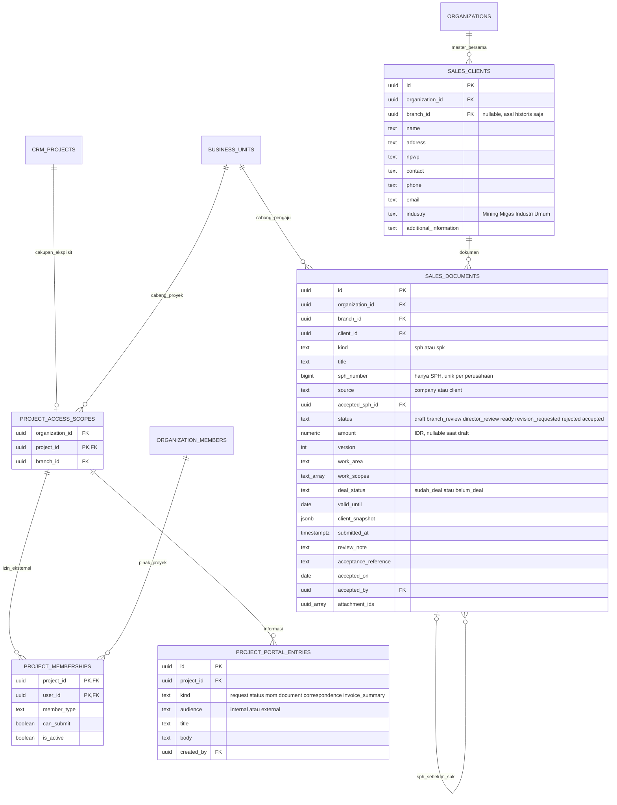
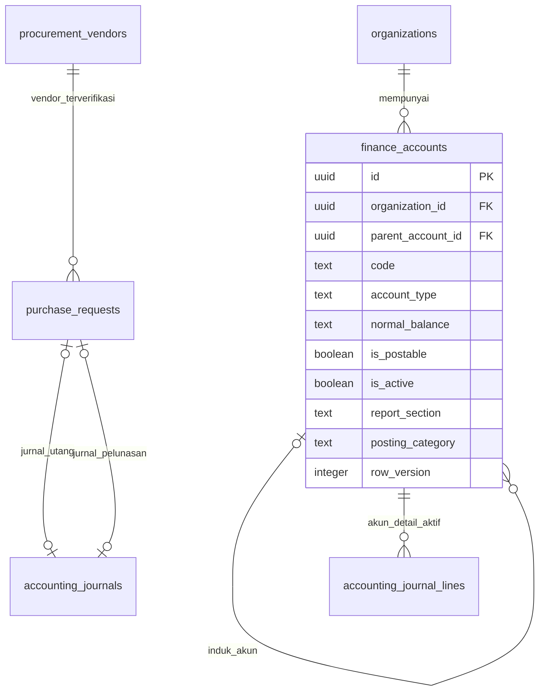

# ERD — ERP Gema Sinergi Peradaban

Dokumen induk model data, diselaraskan dengan [PRD](PRD.md), arahan pemilik 4 November 2026, migration lokal dan [aturan pengembangan](aturan-pengembangan.md). ERD tersendiri belum ditemukan saat dibuat; revisi model berikutnya dilakukan pada dokumen ini.

**Status:** diagram di bawah menggambarkan schema yang disiapkan di repository, bukan bukti seluruh tabel sudah terpasang pada Supabase aktif. Deployment dan hasil verifikasi ada pada [status implementasi](implementasi-2026-11-04.md).

## Konsep perusahaan, orang dan akses

### Batas domain pembelian dan penjualan

Revisi navigasi 5 November 2026: `/vendor` menampilkan satu master `procurement_vendors` untuk kebutuhan proyek/nonproyek, termasuk lab dan subkon. Pemisahan menu dari Pembelian tidak mengubah FK organisasi/cabang atau verifikasi Finance. Tidak ada tabel vendor proyek/nonproyek terpisah. Kategori vendor dan relasi proyek rinci belum ditambahkan. Menu Cuti dan Perjalanan dinas baru berupa halaman awal; belum ada tabel, RPC atau policy baru untuk keduanya.

Ruang pribadi merupakan agregasi baca, bukan tabel pengajuan baru. `purchase_requests`, `procurement_vendors`, `sales_clients`, `sales_documents`, `workflow_documents` dan `operational_work_items` diambil menurut `organization_id` serta `created_by = auth.uid()` untuk daftar Pengajuan saya. RLS tetap berlaku; keanggotaan/cakupan luas owner tidak mengubah daftar pribadi menjadi daftar perusahaan. Antrean review tetap berasal dari permission/RPC pemeriksa, bukan dari filter pembuat. Tidak ada perubahan schema untuk pengelompokan menu ini.

`procurement_vendors`, `purchase_requests` dan jurnal utang/pembayaran merupakan domain pembelian. `sales_clients` dan `sales_documents` merupakan domain penjualan. Penjualan berhubungan dengan pendapatan dari barang/jasa perusahaan; SPH/SPK adalah dokumen alur GSP saat ini, bukan prasyarat universal untuk semua model usaha. Tidak ada FK atau prasyarat klien/SPH/SPK pada pengajuan pembelian.

Pemisahan halaman dan server actions mengikuti batas tabel ini; halaman pembelian tidak melakukan query tabel penjualan dan halaman penjualan tidak melakukan query pembelian/vendor. `finance_accounts` tetap master akuntansi bersama. Organisasi, cabang, penugasan dan infrastruktur lampiran privat dipakai bersama dengan domain/cakupan akses yang sudah ada. Revisi ini tidak mengubah schema atau menggandakan master data.

`organizations` adalah perusahaan/tenant. `business_units` adalah pusat nonoperasional dan tiga lokasi usaha dalam perusahaan yang sama. `company_entities` adalah struktur pembukuan lama; lokasi dipetakan eksplisit ke entitas bertipe branch di bawah satu parent, tanpa membuat wajib pajak baru. `entity_memberships` merupakan model penugasan pembukuan lama; `work_assignments` menjadi sumber cakupan pekerjaan baru. Jangan menyamakan badan hukum, cabang, status orang dan role.

Satu profil hubungan per anggota perusahaan, beberapa penugasan per akun. Role pusat: president, finance_director, technical_director, finance, accounting_tax; role cabang: branch_manager, admin, project_manager, support, other; hr dan marketing dapat bercakupan pusat atau cabang. Profil eksternal tidak mewarisi akses internal. Super Admin ditentukan oleh keanggotaan `role=owner`, bukan `user_metadata`.

## Pengajuan pembelian dan dokumen sumber

### Relasi fisik dan logis

- FK majemuk `(organization_id, branch_id, vendor_id)` memastikan vendor dan pembelian pada perusahaan/cabang yang sama. `vendor_id` boleh kosong pada draft; RPC pengajuan mewajibkan vendor approved.
- `lines` saat ini adalah array JSONB terurut, **bukan tabel purchase_request_lines**. Setiap elemen mempunyai description, account_id dan amount. Trigger memvalidasi COA aktif milik organisasi, nominal, jumlah baris dan perhitungan. Saat konfirmasi COA, setiap baris wajib mempunyai akun. Jika kelak dinormalisasi, perubahan harus memakai migration dan ERD ini diperbarui.
- `vendor_snapshot` menyimpan data vendor yang digunakan dokumen, terpisah dari master hidup. COA/pajak dapat dikoreksi Accounting; keterangan/nominal belanja yang disetujui tidak dapat diganti melalui payload pemeriksaan.
- `attachment_ids` adalah array UUID, bukan FK array yang diperiksa otomatis PostgreSQL. RPC memeriksa keberadaan metadata, organisasi, cabang, domain dan batas jumlah lampiran. Relasi ke objek Storage menggunakan path, bukan FK ke sistem Storage.
- `procurement_events.entity_id` merupakan referensi polimorfik menurut entity_type, bukan FK fisik ke semua tabel. Audit dan keputusan ditulis dalam transaksi yang sama dengan aksi terkait.
- Jurnal mempunyai header serta line double-entry yang sudah ada. Jurnal utang dan pelunasan disambungkan dari pembelian; source_id menelusuri invoice. Utang vendor dan pemotongan dapat berbeda nominal menurut withholding_timing.

### Invarian dan indeks penting

| Area | Aturan schema/RPC |
| --- | --- |
| Tenant | FK majemuk menjaga hubungan perusahaan; RLS/RPC membaca akun Auth yang diverifikasi. |
| Cabang | Hanya kind branch menerima transaksi; pusat memantau gabungan. Mapping pembukuan IDR dan satu parent, terkunci setelah digunakan jurnal. |
| Duplikasi | Indeks invoice pada organisasi/cabang/vendor/nomor invoice yang tidak rejected; jurnal number dan hubungan sumber menjaga posting satu kali. |
| Angka | numeric untuk nominal; total dihitung trigger. JSONB nominal divalidasi, bukan mempercayai total browser. |
| State | CHECK status dan version, row lock pada transisi; hanya tahap yang berwenang dapat memutuskan. |
| Pembayaran | Tanggal tidak mendahului invoice, periode terbuka, jurnal sumber sah, referensi bukti dan akun wajib. |
| Lampiran | Path organisasi/cabang/pengunggah/id, MIME/ukuran dibatasi, bucket procurement-documents privat. SELECT/INSERT dibatasi; UPDATE/DELETE objek terlindungi ditutup. |
| Performa | Indeks work_assignments actor/scope, invoice/queue branch-status, events entity-time, attachments scope, dan jurnal/account/counterparty. |

## Penjualan, proyek dan portal

`sales_clients` dan `sales_documents` adalah model baru; bukan alias otomatis tabel CRM legacy. SPK merujuk SPH ready/accepted untuk klien/cabang yang sama, dengan pemeriksaan kepemilikan pengaju atau override Super Admin. SPH mendapat `sph_number` melalui trigger dan counter transaksional privat `gsp_private.sph_counters`, satu urutan per perusahaan lintas cabang tanpa reset periode. Increment ikut rollback, nomor immutable dan SPH bernomor tidak dapat dihapus. Berkas manual memakai `procurement_attachments` domain `sales`, tanpa OCR otomatis; RPC `attach_sales_document` hanya menambahkan lampiran pada draft milik pengaju atau Super Admin, dengan validasi organisasi/cabang/domain dan audit.

Kebutuhan sambungan berikutnya: proyek berasal dari SPK, draft wajib menyertakan manpower nyata dan ditampilkan pada Pekerjaan saya para anggota. Dokumen RAB, teknis pekerjaan dan timesheet dibuat manual lalu diunggah. Saat ini belum ada FK SPK→CRM project, tabel manpower proyek internal atau pengaitan berkas RAB/timesheet; kebutuhan tersebut tidak dinyatakan terimplementasi oleh migration penomoran. Akses portal proyek eksternal memerlukan proyek aktif, membership aktif dan profil hubungan yang sesuai. Informasi internal tidak ikut terbuka karena seorang klien memperoleh akses proyek.

## Kontrak transaksi aplikasi

Revisi master klien/SPH 5 November: `sales_clients.branch_id` tidak lagi membatasi kepemilikan atau akses; pendaftaran baru menyimpan NULL. FK dokumen ke klien memakai `(organization_id, client_id)`, sedangkan SPK tetap merujuk SPH klien/cabang yang sama. NPWP dinormalisasi digit dan unik per perusahaan, tanpa verifikasi online. `phone`/`email` dipisahkan; `contact` dipertahankan untuk kompatibilitas. Semua anggota internal aktif dapat mendaftar tanpa approval, tetapi SELECT master dibatasi Super Admin, Direksi, Manager, Admin Cabang, PM dan Marketing lintas cabang.

SPH menyimpan snapshot identitas klien dari database, versi dan nilai numeric(18,2). Alur terbaru Manager Cabang → Direktur Keuangan → ready; pengaju Manager melewati tahap Manager. Revisi menjadi revision_requested dan dapat diajukan ulang, penolakan menjadi rejected yang tidak dapat diedit. Deal tidak mengubah persetujuan atau membuktikan kesepakatan klien. Penerimaan bilateral tetap hanya dari ready, tetapi tidak menjadi prasyarat persiapan SPK pada arahan terbaru.

RPC `sph_register` menghasilkan ringkasan terbatas 50 baris dan total berdasarkan cabang/role, tanpa catatan lengkap, snapshot, audit atau attachment_ids. RLS dokumen SPH penuh hanya mengizinkan pengaju yang masih berhak, pemeriksa tahap aktif dan Super Admin; policy metadata/Storage mengikuti hak membuka dokumen. Fungsi ringkasan tidak menggunakan RLS dokumen penuh karena cakupannya berbeda, tetapi implementasi privat memeriksa organisasi/role/cabang secara eksplisit dan wrapper publik invoker/authenticated-only. `sph_spk_context` memeriksa status ready/accepted serta kepemilikan; jalur legacy memakai pemeriksaan yang sama. Fungsi implementasi lama yang dipertahankan sebagai base tidak dapat dieksekusi authenticated secara langsung.

Tidak menambah tabel notifikasi: `sales_notifications` menghitung tugas dari status/penugasan terkini, mengembalikan total dan maksimal 100 item terbaru. Review queue berpindah setelah keputusan; tindak lanjut milik pengaju tampil sesudah ready/revisi/tolak, dan ready hilang dari tindak lanjut setelah SPK dibuat. Keputusan tersimpan permanen pada `procurement_events`, sedangkan notifikasi adalah tugas aktif, tanpa riwayat baca/dismiss atau pengiriman eksternal. Perubahan lampiran menaikkan versi; audit klien memakai branch_id NULL dan dokumen tetap bercabang.

| Proses | RPC |
| --- | --- |
| Konfigurasi awal | initialize_purchasing_workspace: owner-only, satu bulan periode cabang, COA awal tanpa saldo atau transaksi; aman dipanggil ulang |
| Akses | save_work_assignment, remove_work_assignment, link_business_unit_entity |
| Vendor | save_procurement_vendor, review_procurement_vendor |
| Pembelian | save_purchase_request, submit_purchase_request, review_purchase_request, pay_purchase_request |
| Ringkasan | purchase_review_queue, purchase_branch_report |
| Penjualan | save_sales_client, can_register_sales_client, can_read_sales_clients, save_sph_request, decide_sph, review_sph_request (legacy), sph_register, sales_notifications, sph_spk_context, sph_review_allowed, sph_review_queue, save_sales_document, accept_sales_sph, attach_sales_document |
| Portal | configure_project_scope, set_project_portal_access, list_portal_projects, save_project_portal_entry |

Implementasi privileged berada di gsp_private; public wrapper mengekspos operasi bisnis dengan pemeriksaan aktor dan grant eksplisit. Mutasi master/dokumen bisnis tidak dibuka lewat UPDATE langsung. Metadata lampiran mempunyai INSERT terbatas dengan RLS dan validasi path. Modul lama yang belum memiliki pemetaan cabang tetap dibatasi pada Super Admin; pembukaan modul berikutnya memerlukan model data/cakupan yang jelas, bukan memperluas policy seluruh organisasi.

## Migration sumber

### Revisi master COA dan sambungan pembelian

`finance_accounts` tetap menjadi satu master perusahaan. Kolom tambahan: `is_postable boolean`, `report_section text`, `posting_category text`; `parent_account_id` mengarah ke `finance_accounts.id` dalam organisasi yang sama. `row_version` dipakai untuk optimistic locking pada penyuntingan. Kelompok induk harus non-posting dan memiliki jenis/kelompok laporan sama dengan anak. Siklus, induk lintas organisasi, kelompok posting dan penonaktifan induk dengan anak aktif ditolak trigger.

`gsp_private.coa_recommendations` menyimpan 98 node template tanpa saldo; schema privat, RLS aktif dan tidak ada akses klien. RPC publik `save_finance_account` dan `install_recommended_coa` memakai invoker wrapper dan pemeriksaan jabatan pusat pada implementasi privat. Mutasi langsung klien tetap ditolak. Audit menyimpan sebelum/sesudah dan sumber pemasangan template. Jurnal seluruh sumber memvalidasi akun detail aktif; akun terpakai dikunci klasifikasinya.

Lampiran tetap pada `procurement_attachments` dan bucket privat yang sama. POST `/api/invoice-documents/[id]` membaca kembali berkas dengan sesi pengguna dan RLS; tidak menyalin lampiran atau membuat pengajuan. Teks hasil OCR dikirim ke formulir untuk ditinjau, tidak menjadi posting akuntansi otomatis.

1. `supabase/migrations/202610290001_foundation.sql` sampai `20261102000100_accounting_advance_workflows.sql`: fondasi organisasi, workflow dan akuntansi sebelumnya.
2. `supabase/migrations/20261104044243_branch_procurement_foundation.sql`: model pusat/cabang, profil/penugasan, vendor/pembelian/penjualan/portal, transisi akses legacy.
3. `supabase/migrations/20261104051705_procurement_documents.sql`: metadata lampiran, bucket privat dan policy Storage.
4. `supabase/migrations/20261104075321_unique_branch_accounting_mapping.sql`: indeks unik mencegah dua cabang memakai unit pembukuan yang sama, termasuk saat permintaan bersamaan.
5. `supabase/migrations/20261104092327_hierarchical_coa_and_posting_guards.sql`: COA berjenjang, template, RPC pengelolaan, audit dan guard akun jurnal/pembayaran.

Jangan menjalankan ulang migration lama pada project berisi data. Cocokkan ledger dan schema aktif terlebih dahulu. Diagram harus diperbarui ketika perubahan migration mengubah relasi, cakupan atau status bisnis.
