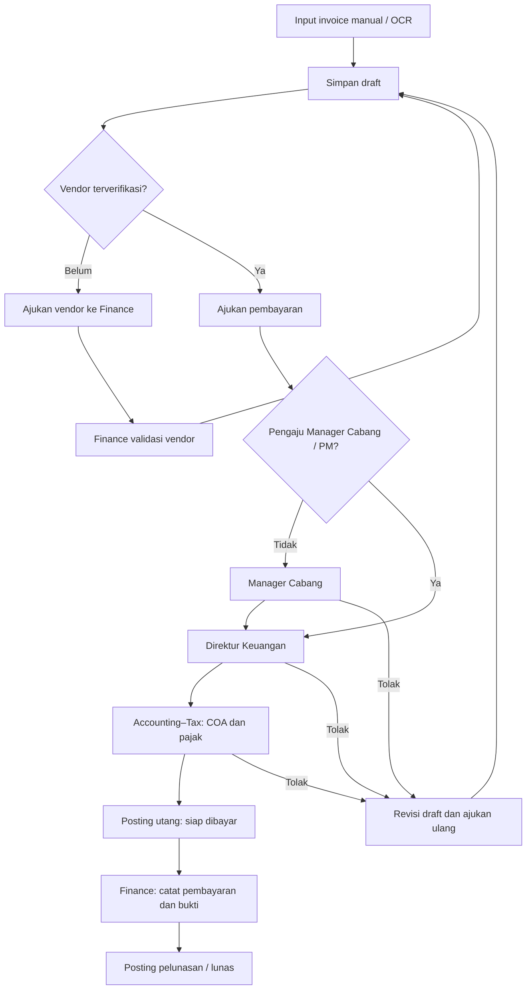

# PRD — ERP Gema Sinergi Peradaban

Dokumen induk kebutuhan produk. Baseline dan revisi: arahan pemilik sistem pada 4 November 2026, termasuk struktur pusat–cabang, dua lapisan akses, pengajuan pembelian dan penjualan, serta aturan dokumentasi. Dokumen ini dibuat karena PRD tersendiri belum ditemukan; kebutuhan berikutnya memperbarui dokumen ini.

Rujukan: [ERD](ERD.md), [aturan pengembangan](aturan-pengembangan.md), [dasar pajak/jurnal](pajak-dan-jurnal-pembelian.md), [status implementasi dan aktivasi](implementasi-2026-11-04.md).

## Tujuan dan prioritas

Format nominal di seluruh modul menggunakan titik ribuan dan koma desimal, termasuk saat input: `1.250.000,50`. Tampilan uang konsisten dua angka desimal. Pengiriman formulir menggunakan nilai kanonis `1250000.50` tanpa pemisah ribuan; isian ambigu/tidak valid ditolak dengan pesan dan tidak diubah diam-diam menjadi nol. Nomor dokumen, rekening, NPWP dan identitas tetap utuh. Tidak mengubah alur persetujuan atau memulai transaksi Pembelian/staging.

Arahan terbaru 5 November 2026: fokus sekarang Klien dan SPH. Pengisian transaksi pembelian serta mulai staging ditunda sampai konfirmasi pemilik. Penyempurnaan Penjualan tidak menjalankan konfigurasi pembukuan atau membuat transaksi pembelian.

Navigasi dashboard membuka setiap modul di tab baru, termasuk pilihan Klien/SPH/SPK dari popup Penjualan. Tautan menggunakan `noopener noreferrer`. Dokumen kelengkapan yang diunggah (PDF/PNG/JPEG) dapat dilihat langsung di tab baru tanpa perlu mengunduh terlebih dahulu; akses pratinjau tetap mengikuti sesi dan RLS/Storage privat.

### Revisi batas modul pembelian dan penjualan

Revisi navigasi berikutnya: label menu/halaman cukup **Pembelian** dan **Penjualan** di kelompok Pengajuan. **Pekerjaan saya** menjadi kelompok tersendiri berisi ruang kerja, **Pengajuan saya**, dan **Persetujuan**. Pengajuan saya (`/pekerjaan-saya/pengajuan`) mengumpulkan dokumen/pendaftaran/pengajuan yang dibuat akun aktif; seluruh sumber wajib difilter `organization_id` dan `created_by`, termasuk ketika aktornya Super Admin. Antrean verifikasi/pelaksanaan ditentukan kewenangan, dipisahkan dari daftar buatan sendiri. Sumber saat ini: pembelian, usulan vendor, klien, SPH/SPK, workflow dan pekerjaan operasional. Modul baru menambahkan sumber milik pengguna pada ruang ini, bukan menaruh menu pribadi di kelompok Pengajuan bisnis.

Pengajuan Pembelian sementara hanya berisi pembelian, tanpa submenu Vendor atau Daftar akun (COA). Pengelolaan COA tersedia melalui Keuangan → Bagan Akun; pilihan COA dalam rincian transaksi tetap memakai master akuntansi perusahaan yang sama. Klien, SPH dan SPK tidak menjadi tab atau dependensi pemuatan halaman pembelian.

Pengajuan Penjualan adalah ruang kegiatan yang menghasilkan pendapatan dari barang/jasa perusahaan. Klien, SPH dan SPK dikelola di halaman, formulir dan server actions penjualan tersendiri. Urutan klien → SPH disetujui → SPK merupakan kebutuhan GSP saat ini; penyesuaian untuk perusahaan lain mengikuti model usaha dan dokumen penjualannya, bukan asumsi bahwa seluruh perusahaan menjual proyek. Konfigurasi alur lintas perusahaan belum dibuat pada revisi pemisahan navigasi ini.

Halaman utama: `/pengajuan/pembelian`, menu Vendor mandiri `/vendor` di kelompok Operasional, dan modul terpisah `/pengajuan/penjualan`. Navigasi pembelian tidak menampilkan daftar vendor maupun Klien/SPH/SPK. Tautan lama `/pengajuan/vendor` dan `/pengajuan?view=vendor` dialihkan ke `/vendor` dengan pesan proses dipertahankan.

Revisi 5 November 2026: daftar Vendor menggabungkan kebutuhan proyek dan nonproyek, termasuk vendor lab dan subkon. Jenis kebutuhan/proyek dicatat pada transaksi; tidak dibuat master terpisah atau duplikasi vendor karena jenis pembayaran. Pembatasan cabang dan verifikasi Finance tetap berlaku. Kategori lab/subkon dan relasi proyek rinci belum ditambahkan ke schema pada revisi navigasi ini.

Kelompok Pengajuan juga memuat Cuti (`/pengajuan/cuti`) dan Perjalanan dinas (`/pengajuan/perjalanan-dinas`). Tahap ini hanya menu dan halaman pemberitahuan belum aktif. Form, saldo/jenis cuti, biaya perjalanan, penyimpanan dan persetujuan menunggu aturan lanjutan.

Perusahaan mengelola kegiatan operasional, proyek, SDM dan keuangan tiga lokasi dalam satu sistem, dengan pembatasan akses dan pemeriksaan berjenjang. Prioritas sekarang adalah **pengajuan pembelian yang dapat digunakan dan tersimpan sampai pembayaran**, kemudian sambungannya ke operasional. Tidak membuat staging pada tahap ini.

Kode, tampilan atau tes lokal yang selesai belum berarti fitur aktif. Pengajuan pembelian baru dinyatakan operasional setelah migration diterapkan pada project Supabase aplikasi yang benar, konfigurasi cabang/COA/periode lengkap, dan penyimpanan serta pembacaan berhasil melalui akun yang berwenang. Jangan menghilangkan pesan belum siap dengan menyimpan data ke browser atau melewati RLS.

## ORG — Struktur dan identitas

| ID | Kebutuhan |
| --- | --- |
| ORG-01 | Satu badan usaha dan satu pelaporan pajak; pusat tidak menjalankan usaha sendiri. Pusat menggabungkan kegiatan dan laporan Surabaya, Jogjakarta, Jakarta. Lokasi bukan tiga badan hukum/wajib pajak terpisah. |
| ORG-02 | Super Admin adalah pemilik sistem, reviewer dan pemantau, dengan akses penuh lintas bidang/cabang. Key database `owner` dipertahankan. Perubahan dan pengecualian keputusan tetap diaudit. |
| ORG-03 | Pengguna pusat: Direktur Utama, Direktur Keuangan, Direktur Teknis, Finance, Accounting–Tax, SDM. Direksi melihat seluruh cabang; fungsi keuangan dan SDM menurut bidangnya. |
| ORG-04 | Pengguna cabang: Manager Cabang, Admin, Project Manager/PIC, SDM, Support dan lainnya. Data cabang lain tidak terbaca melalui halaman, API, RPC, laporan atau berkas. |
| ORG-05 | Satu akun memiliki ruang pribadi dan akses pekerjaan. Hubungan probation, kontrak, tetap, konsultan/tenaga ahli, vendor atau klien dipisahkan dari jabatan/cakupan. Satu orang dapat memegang beberapa penugasan, termasuk Accounting–Tax sekaligus Finance. |
| ORG-06 | Konsultan/vendor/klien mendapat cakupan proyek eksplisit. Klien hanya melihat proyek aktif yang diberikan dan informasi yang dibagikan, bukan seluruh cabang atau buku besar. |
| ORG-07 | Daftar jabatan bukan instruksi membuat akun fiktif. Akun Auth nyata ditambahkan saat identitas siap. Pencabutan penugasan langsung menghapus akses tanpa menunggu JWT diperbarui. |

## PUR — Pengajuan pembelian

### PUR-01: Pengaju dan ruang lingkup

Pengaju dapat merupakan pengguna internal cabang mana pun yang memiliki penugasan pada cabang tersebut. Pengguna tidak boleh memalsukan cabang melalui payload/URL. Super Admin dapat mengoperasikan seluruh cabang. Setiap invoice, vendor, lampiran, tahap pemeriksaan, jurnal dan laporan dapat ditelusuri ke cabangnya.

Jika pembukuan masih kosong, Super Admin mendapatkan konfigurasi awal yang dapat ditinjau: bulan pembukuan, satu induk pelaporan, tiga unit cabang dan COA awal untuk pembelian. Akun awal mencakup kas/bank, PPN masukan, persediaan/aset, utang usaha/PPh, dan beban. Proses tidak menimpa COA yang sudah ada serta tidak membuat saldo, transaksi, vendor atau invoice contoh. Kode akun awal perlu disesuaikan dengan kebijakan klien sebelum posting pertama.

### PUR-02: Input manual atau OCR

Pengaju dapat mengisi manual atau mengunggah invoice agar OCR membantu mengisi draft. Simpan berkas sumber pada penyimpanan privat. Form memuat:

| Bagian | Data dan perilaku |
| --- | --- |
| Header | Cabang, nomor/tanggal invoice, nomor/tanggal faktur pajak terpisah, rencana tanggal pembayaran dan catatan. |
| Penagih | Nama/alamat penagih dari invoice; pilihan vendor terdaftar. Informasi ini dibedakan dari pemeriksaan identitas vendor. |
| Rincian dinamis | Nomor urut, keterangan, COA, nominal sebelum PPN. Pengaju dapat menambah/menghapus baris draft. COA mengarah pada beban/aset yang sesuai substansi, bukan selalu beban. |
| Pajak | Pilihan PPN dan satu jenis pemotongan PPh per invoice, dasar pemotongan, tarif yang relevan, pengkreditan PPN dan saat pengakuan PPh. Accounting–Tax mengonfirmasi perlakuannya. |
| Jurnal | Pratinjau detail debit/kredit utang serta pelunasan. Nominal final dihitung ulang di database. |
| Vendor/bayar | Nama vendor, NPWP/identitas pajak, nama pemilik rekening, nomor rekening, metode pembayaran, rencana tanggal pembayaran manual. |
| Bukti | Lampiran sumber, identitas pengaju, versi dan riwayat pemeriksaan. |

OCR tidak menyetujui dokumen, memilih COA atau menetapkan pajak. Nominal yang samar diberi peringatan dan dikoreksi manual. Kemampuan lokal saat ini: PDF/PNG/JPEG maksimal 10 MB, OCR Windows dan PDF maksimal lima halaman; fallback manual tersedia. Batas implementasi dicatat pada status, bukan dianggap kebutuhan hosting final.

### PUR-03: Vendor baru dan vendor terdaftar

- **Master Vendor Bersama Perusahaan (Lintas Cabang):** Vendor terverifikasi (status = 'approved') adalah master rekanan bersama milik satu perusahaan (organization_id), bukan milik eksklusif satu cabang dan tidak diisolasi per cabang. Vendor yang didaftarkan oleh Cabang Surabaya dan disetujui Finance Pusat otomatis dapat dipilih dan digunakan oleh Cabang Jakarta, Jogjakarta, maupun Pusat untuk pengajuan pembelian mereka masing-masing.
- Pengaju internal cabang mana pun dapat memilih vendor terdaftar dari master vendor perusahaan yang telah disetujui; tampilkan identitas pajak dan rekeningnya.
- Jika belum terdaftar, pengaju mengisi informasi vendor dari area vendor pada formulir dan memilih **Ajukan ke Finance**. Draft invoice tetap dapat dilanjutkan/disimpan.
- Usulan vendor masuk antrean Finance pusat. Finance memeriksa identitas, alamat, NPWP/identitas pajak, pemilik/nomor rekening dan metode pembayaran, lalu menyetujui/menolak dengan jejak audit.
- Vendor disetujui masuk master vendor dan dapat dipilih. Pengajuan pembayaran tidak dapat dikirim sebelum vendor disetujui.
- Master vendor tidak otomatis membuat akun Auth vendor. Hak login dan cakupan proyek merupakan proses terpisah.
- Dokumen yang diajukan menyimpan snapshot vendor. Perubahan master tidak boleh mengubah diam-diam tujuan pembayaran dokumen yang sudah diperiksa.

### PUR-04: Alur dan keputusan

Status: `draft → branch_review → director_review → accounting_review → payment_ready → paid`, dengan `rejected` untuk revisi. Pengajuan Manager Cabang/Project Manager langsung ke `director_review`. Dokumen terkirim terkunci, perubahan memakai versi yang benar.

Pengguna biasa tidak menyetujui pengajuan sendiri. Super Admin dapat memeriksa sebagai pemilik, dengan audit override. Accounting–Tax dan Finance boleh satu akun; pemeriksaan serta pembayaran tetap peristiwa terpisah. Finance boleh mengeksekusi pembayaran atas pengajuannya setelah persetujuan independen lengkap.

Accounting mengoreksi COA dan pajak berdasarkan invoice; nominal/keterangan belanja yang sudah disetujui tidak dapat dinaikkan atau diganti di tahap ini. Ketidaksesuaian substansi dikembalikan sebagai revisi pengajuan.

### PUR-05: Pajak dan jurnal

Dasar rinci dan tautan sumber dipelihara pada [pajak/jurnal](pajak-dan-jurnal-pembelian.md). Implementasi mendukung PPN umum nonmewah 12% × DPP 11/12, DPP penuh sesuai objek, tanpa PPN, serta pilihan PPh 23 jasa/sewa non-tanah-bangunan, final sewa tanah/bangunan, konstruksi sesuai kualifikasi, dan PPh 21 bukan pegawai. PPh 21 konsultan orang pribadi menggunakan perhitungan sesuai klasifikasi penerima; jangan menyamakan otomatis dengan TER pegawai.

Satu jenis PPh dipilih, tidak ditumpuk pada dasar yang sama. Perlakuan khusus di luar pilihan yang didukung harus ditinjau; jangan memilih tarif terdekat. Pengkreditan PPN memerlukan nomor/tanggal faktur dan pemeriksaan Accounting–Tax. Keberadaan nomor bukan validasi online faktur.

Posting utang mendebit COA rincian serta PPN masukan jika dapat dikreditkan, kemudian mengkredit utang vendor dan utang PPh sesuai saat pengakuannya. Pelunasan mendebit utang vendor dan mengkredit kas/bank serta PPh bila pemotongan baru diakui saat pembayaran. PPh tidak dibukukan dua kali. Semua jurnal harus berimbang, memakai periode terbuka, entitas pembukuan cabang yang dipetakan, dan mata uang IDR pada tahap ini.

Pencatatan pembayaran membutuhkan tanggal aktual, referensi bukti, akun kas/bank dan periode. Aplikasi belum melakukan transfer bank. Pengulangan klik/RPC tidak menggandakan jurnal. Koreksi jurnal posted harus melalui alur sumber yang terlacak; reversal generik pembelian ditutup sampai workflow koreksi sumber tersedia.

### PUR-06: Sambungan wajib

1. **Pekerjaan saya / butuh verifikasi saya:** vendor dan pengajuan tampil hanya untuk tahap yang dapat ditindak oleh akun tersebut.
2. **Akuntansi:** jurnal utang/pajak/beban/aset serta pelunasan masuk buku besar dan subledger vendor.
3. **Dashboard pekerjaan:** ringkasan sesuai jabatan dan cabang; saldo utang/pembayaran berasal dari posting atau status yang didefinisikan jelas.
4. **Laporan cabang/pusat:** pengguna cabang terkunci pada cakupannya; pusat melihat gabungan yang sesuai bidangnya.
5. **Operasional:** hubungan ke proyek/bisnis dikembangkan setelah pengajuan dasar dapat digunakan; jangan menganggap SPK/draft otomatis menjadi pekerjaan atau pendapatan.

## SAL — Penjualan dan portal

- SAL-01: Penjualan membuka popup pilihan **Klien**, **SPH**, **SPK**. Masing-masing mempunyai halaman, formulir dan daftar tersendiri. Klien adalah master calon mitra bersama satu perusahaan, tanpa pilihan/kepemilikan cabang. Isian: nama, alamat, NPWP, nomor kontak, email, jenis usaha (Mining/Migas/Industri/Umum), dan informasi lainnya opsional. Pengguna internal aktif boleh mendaftarkan klien tanpa persetujuan; akses daftar dibatasi pada Super Admin, Direksi, Manager Cabang, Admin Cabang, Project Manager dan Marketing. Role lain dapat mendaftarkan tanpa mendapat akses daftar. Identitas divalidasi format; NPWP tidak diverifikasi online.
- SAL-01a: popup menggunakan panel ikon seperti contoh pemilik: latar gelap/buram, panel putih membulat dan tiga ikon berjajar. Dashboard/dock desktop membuka popup langsung tanpa halaman form perantara. Pilihan membuka `/pengajuan/penjualan/klien`, `/pengajuan/penjualan/sph` atau `/pengajuan/penjualan/spk`. Form/daftar tiap halaman tidak tercampur. Nama perusahaan/peran di kiri atas halaman modul menjadi tautan kembali ke dashboard.
- SAL-02: SPH menggunakan klien perusahaan yang sama dan cabang pengaju sesuai penugasannya. Dropdown cabang tetap tampil; pengguna cabang hanya mendapat cabang yang diizinkan, Super Admin/direksi pusat mengikuti cakupan lintas cabangnya. Pilih klien melalui dropdown dengan pencarian, halaman data 10 klien dan scroll untuk melanjutkan. Isian: judul penawaran, daerah pengerjaan, checklist Pertek/UKL/UPL/Amdal/DELH/DPLH/Andalalin/LB 3/Lainnya (dua baris desktop), bidang usaha dari klien, sudah/belum deal, tanggal akhir masa berlaku, catatan/arahan khusus dan lampiran tambahan. Nomor urut 1, 2, 3 dan seterusnya berlaku satu perusahaan lintas cabang tanpa reset periode. Nomor dialokasikan saat simpan draft secara transaksional; gagal simpan tidak menghabiskan nomor. Nomor immutable dan SPH bernomor tidak dapat dihapus. Akses cabang dapat membuat nomor yang terlihat tidak bersebelahan, sedangkan register perusahaan tetap utuh.
- SAL-02a: Draft minimal mempunyai cabang, klien dan judul. Submit memerlukan data lengkap termasuk nilai SPH positif (IDR, maksimal dua desimal) dan konfirmasi: Ya mengajukan, Tidak menyimpan draft. Sesudah simpan/submit, halaman kembali ke daftar SPH cabang. Jalur terbaru: Manager Cabang → Direktur Keuangan → pengaju untuk tindak lanjut. Pengaju Manager langsung ke Direktur; PM tetap melalui Manager. Keputusan Setujui/Revisi/Tolak diaudit; Revisi/Tolak wajib beralasan. Revisi dapat diajukan ulang dari awal sesuai jabatan pengaju, sedangkan Tolak mengakhiri pengajuan. Dokumen terkirim/ditolak terkunci, pemeriksaan memakai versi yang benar. Larangan persetujuan sendiri tetap berlaku selain override Super Admin yang diaudit. Accounting–Tax/Finance tidak menjadi pemeriksa SPH.
- SAL-02b: Daftar SPH meliputi seluruh pengaju dalam cakupan cabang, tanpa filter pembuat: nomor urut tabel, nomor SPH, tanggal dibuat, judul singkat, lingkup, nilai, status/posisi pemeriksa dan tindakan Buat SPK. Ringkasan rekan tidak membuka detail, catatan, audit atau lampiran. Detail hanya pengaju dengan akses cabang yang masih aktif, pemeriksa tahap aktif atau Super Admin. Batas ini berlaku pada RLS, RPC, Storage dan jalur legacy. Daftar dipaginasi 50 baris dengan filter cabang dan jumlah total. Pengajuan saya tetap memakai filter pembuat.
- SAL-02c: Notifikasi di dalam aplikasi menampilkan Butuh persetujuan saya untuk pemeriksa tahap aktif. Sesudah Direktur menyetujui, Revisi atau Tolak, pengaju menerima SPH perlu tindak lanjut beserta status/catatan. Sumber notifikasi adalah status dokumen dan penugasan terkini, bukan daftar penerima yang menjadi usang ketika akses dicabut. Lonceng diperbarui saat dibuka, tab kembali fokus atau tiap 30 detik selama tab terlihat; kegagalan terlihat. Antrean dashboard/Persetujuan tetap tersedia. Tidak ada email/WhatsApp/push eksternal pada tahap ini.
- SAL-03: Setelah Direktur Keuangan menyetujui, status ready/Disetujui memungkinkan pengaju atau Super Admin memilih Buat SPK. Ini menggantikan syarat approval Accounting–Tax/Finance dan syarat penerimaan bilateral sebelum persiapan SPK. Bukti kesepakatan klien tetap informasi tersendiri, tidak dianggap terjadi karena status deal atau approval internal. Buat SPK menuju `/pengajuan/penjualan/spk/baru?sph=...` dengan referensi SPH terverifikasi; menu SPK menuju daftar SPK. Rincian form SPK menunggu arahan berikutnya; halaman baru baru menyiapkan konteks SPH, belum membuat kontrak. Dokumen manual memakai unggah privat PDF/PNG/JPEG maksimal 10 MB per berkas, tanpa OCR otomatis.
- SAL-05: Penjualan SPK yang disetujui memicu pembuatan proyek otomatis berstatus draft yang kemudian dikelola melalui modul Manajemen Proyek (lihat bagian PRJ di bawah).
- SAL-04: portal proyek memuat permintaan data/tanggapan, status proses, MoM, dokumentasi, surat-menyurat dan informasi tagihan yang dibagikan. Akses per proyek aktif dan penerima internal/eksternal. Unggah berkas portal, percakapan berutas, notifikasi dan otomatisasi invoice adalah pengembangan berikutnya.

## PRJ — Manajemen Proyek dan Perencanaan Lapangan (RAB, Manpower, Timesheet, Verifikasi Direksi)

- **PRJ-01 (Pembentukan Otomatis dari SPK):** Saat SPK disetujui (ACC) langsung oleh Direktur Utama, entitas proyek baru di `crm_projects` otomatis dibentuk dengan kode resmi `PRJ/{CLIENT}/{CABANG}/{MMYY}.{SEQ}`. Status awal proyek adalah `draft` (bukan langsung `active`). Proyek menautkan `spk_id`, `client_id`, `branch_id`, dan `contract_amount` dari SPK.
- **PRJ-01a (Keterbukaan Data & Pemantauan Direksi Lintas Cabang):** Seluruh jajaran Direksi (**Direktur Utama**, **Direktur Keuangan**, dan **Direktur Teknis**) memiliki hak akses penuh untuk melihat, membaca, dan memantau seluruh dokumen pengajuan di semua cabang (SPH, SPK, Pengajuan Pembelian, Proyek, dan seluruh dokumen lampiran berkas PDF/gambar). Kewenangan persetujuan dipisahkan secara fungsional: Persetujuan SPK langsung kepada Direktur Utama, sedangkan persetujuan SPH dan Pembelian kepada Direktur Keuangan. Direktur yang tidak bertindak sebagai approver tetap dapat meninjau rincian dokumen dan lampiran agar jajaran direksi selalu terkoneksi secara data dan laporan.
- **PRJ-02 (Perencanaan & Mobilisasi Cabang):** Proyek berstatus draft masuk ke antrean kerja Admin Cabang dan Manager Cabang untuk dilengkapi melalui formulir terpadu (`/proyek/[id]`):
  1. **Tim SDM / Man Power:** Daftar personil nyata meliputi Project Manager (PM) / Team Leader, Tenaga Ahli (KTPA/ATPA/Sipil/dll.), serta surveyor/drafter, termasuk sertifikasi dan estimasi durasi kerja.
  2. **Rincian Teknis & Deliverables:** Uraian metodologi teknis, kebutuhan alat/logistik lapangan, dan produk dokumen akhir (Amdal, UKL-UPL, Pertek, Andalalin, dll.).
  3. **Jadwal & Timesheet Milestones:** Tahapan pengerjaan (sampling, pengujian lab, draf laporan, sidang dinas) beserta tanggal mulai, target selesai, dan PIC.
  4. **Rencana Anggaran Biaya (RAB Proyek):** Rincian pos belanja (biaya personil, non-personil, uji lab, sidang perizinan, operasional) dengan volume, satuan, dan harga satuan. Sistem menghitung total RAB dan estimasi *Gross Profit Margin* terhadap nilai SPK secara real-time.
  5. **Lampiran Dokumen Teknis & RAB:** Unggahan dokumen pendukung (KAK/TOR, penawaran lab rekanan, draft RAB detail format Excel) berkapasitas maksimal 10 MB per berkas.
- **PRJ-03 (Verifikasi Direksi & Pengesahan Direktur Utama):**
  - Setelah data lengkap, Manager Cabang melakukan pengajuan (Submit) proyek ke jajaran Direksi (`approval_status = 'director_review'`).
  - Direktur Teknis memverifikasi kesiapan tim ahli dan jadwal metodologi kerja.
  - Direktur Keuangan mengevaluasi kelayakan margin laba kotor RAB vs Kontrak SPK.
  - **Direktur Utama (President)** memiliki wewenang eksekusi akhir:
    - **Setujui Proyek (ACC):** Mengubah status proyek menjadi `active`.
    - **Minta Revisi:** Mengembalikan draf ke cabang (`approval_status = 'revision_requested'`) dengan catatan arahan wajib.
    - **Tolak Proyek:** Membatalkan proyek (`approval_status = 'rejected'`).
- **PRJ-04 (Pagu Anggaran RAB Terkunci / Budget Baseline):**
  - Saat Direktur Utama menyetujui proyek, seluruh pos rincian RAB terkunci sebagai Pagu Anggaran (Budget Baseline).
  - Pengajuan Pembelian (`purchase_requests`) dan Kasbon operasional yang ditautkan ke proyek wajib mengacu pada pagu pos anggaran terkait guna mencegah pembengkakan biaya (*cost overrun*).
- **PRJ-05 (Portal Proyek Kolaboratif):** Proyek yang telah aktif terintegrasi dengan Portal Proyek (`/portal-proyek`) untuk surat-menyurat, Minutes of Meeting (MoM), dan pertukaran informasi teknis dengan pihak eksternal (Klien/Konsultan/Vendor).

## Kriteria penerimaan dan status

### Revisi COA, pengguna dan OCR — 4 November 2026

- Pengajuan memakai master vendor yang telah disetujui; pembuatan master vendor tidak membuat akun Auth. Setiap pegawai/pemeriksa nyata menggunakan akun sendiri dan penugasan pusat/cabang. Accounting–Tax dan Finance dapat dipegang satu akun bila orangnya sama. Pengujian role tidak membuat akun produksi fiktif.
- Bagan akun perusahaan berjenjang tersedia pada **Keuangan → Bagan Akun**. Super Admin, Accounting–Tax pusat dan Finance pusat dapat menambah/mengubah kelompok dan akun detail. Direksi/auditor sesuai cakupan dapat membaca. Satu chart digunakan tiga cabang; jurnal menyimpan dimensi cabang.
- Rekomendasi awal terdiri dari 98 kelompok/akun dalam tujuh akar: aset, liabilitas, ekuitas, penghasilan usaha, beban/biaya, penghasilan lain dan penghasilan komprehensif lain. Kas/setara kas, piutang dan utang mempunyai kelompok tersendiri. Kode merupakan kebijakan perusahaan, bukan kode wajib PSAK. Tidak membentuk saldo atau transaksi contoh.
- Kelompok tidak dapat dijurnal atau dipilih pada rincian pembelian. Hanya akun detail aktif yang dapat digunakan. Pembayaran memakai kategori kas/bank. Akun yang pernah digunakan jurnal tidak boleh diubah klasifikasi/kodenya; perubahan nama/status tetap diaudit. Penyuntingan memakai versi agar perubahan pengguna lain tidak tertimpa.
- Rincian pajak berbentuk tabel horizontal bernomor: satu baris PPN dan satu baris pilihan PPh, dasar, tarif, perlakuan/saat pengakuan dan nominal. Tidak mengalikan beberapa jenis PPh pada dasar yang sama.
- PDF digital dibaca dari lapisan teks secara lokal; PDF pindai dan gambar menggunakan OCR Windows lokal dengan rekonstruksi baris berdasarkan posisi. Maksimal 10 MB/lima halaman; hasil hanya mengisi draft. Tersedia baca ulang lampiran tanpa unggah ulang. Kolom yang tidak terbaca disebutkan jelas dan tetap diisi manual; tidak menebak nomor, vendor, COA atau pajak.
- Acuan standar dan batas penerapan disimpan pada [dasar pajak dan jurnal](pajak-dan-jurnal-pembelian.md). PSAK 118 berlaku mulai 1 Januari 2027; jangan menyatakan sudah wajib untuk periode November 2026.

| ID | Bukti selesai yang diperlukan |
| --- | --- |
| AC-01 | Akun nyata dapat membuka, menyimpan dan membaca kembali draft pada Supabase aktif; halaman bukan hanya pesan migration. |
| AC-02 | Vendor baru dapat diajukan dari alur pembelian, masuk antrean Finance, dan hanya dapat dipakai mengirim pembayaran setelah disetujui. |
| AC-03 | Uji pengaju biasa dan Manager/PM menghasilkan urutan pemeriksa yang benar; role/cabang salah ditolak database. |
| AC-04 | COA/pajak diperiksa sebelum posting; nominal yang disetujui terlindungi; kedua jurnal berimbang dan dapat ditelusuri. |
| AC-05 | Pembayaran ganda, versi lama, lintas organisasi/cabang, dan sisipan lampiran domain lain ditolak. |
| AC-06 | Lampiran privat tidak bocor melalui policy lama, akun eksternal, URL publik atau perubahan bucket. |
| AC-07 | Ringkasan/tugas/buku besar mencerminkan transaksi yang benar-benar tersimpan dan hak aksesnya. |
| AC-08 | Perubahan kebutuhan memperbarui PRD/ERD/rules yang sama; dokumen baru hanya jika jenisnya belum ada. |

Kode dan tes lokal untuk fondasi tersedia. Migration pengajuan dan storage sudah diterapkan melalui CLI ke project `cjxsdoxlrnpyhigkudha`; RLS, RPC, bucket privat dan ledger sudah diverifikasi. Karena pembukuan sebelumnya kosong, Super Admin mendapat konfigurasi awal yang dapat ditinjau sebelum invoice pertama. Pembuktian transaksi bisnis nyata tetap memerlukan bukti yang diberikan pengguna; jangan menandai lifecycle produksi selesai hanya berdasarkan build/PGlite. Lihat status implementasi untuk bukti terbaru.
